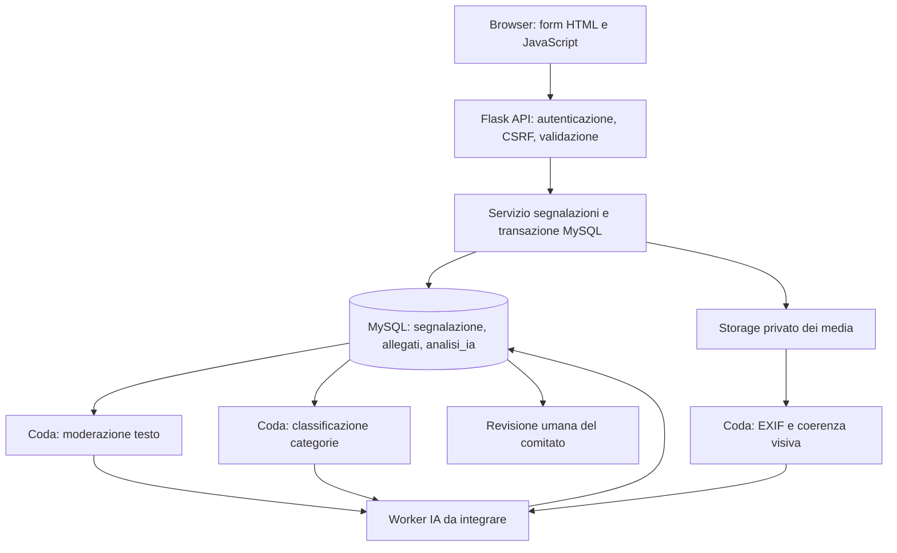

# Predisposizione all'integrazione IA

La webapp crea record `analisi_ia` in stato `In attesa` per moderazione testo, classificazione e verifica multimediale. È quindi rappresentato il flusso dati e la persistenza dell'esito; non sono inclusi modelli, provider esterni o worker. Prima dell'attivazione occorre definire soglie, gestione dei falsi positivi, modello e versione, tempi di conservazione, minimizzazione dei dati e procedura di contestazione. L'estrazione EXIF di immagini è invece implementata durante il caricamento; se le coordinate EXIF sono presenti vengono usate come posizione iniziale, modificabile dall'utente nel form.
