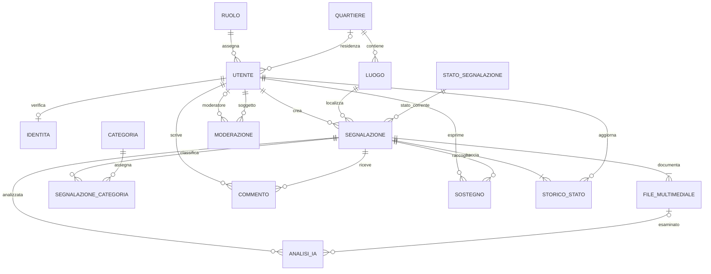

# Progettazione concettuale e logica

## Modello ER

Il requisito `SEGNALAZIONE 1..N FILE_MULTIMEDIALE` vale per una segnalazione pubblicata. Per consentire transazioni atomiche, il record nasce come bozza, vengono salvati allegati e metadati e infine viene pubblicato; il trigger MySQL impedisce la pubblicazione senza allegato.

## Schema relazionale normalizzato

I campi marcati `PK` sono chiavi primarie; `FK` sono chiavi esterne; i vincoli completi e gli indici sono in `database/schema/schema.sql`.

- **RUOLO**(`id_ruolo` PK, `nome_ruolo` UNIQUE, descrizione)
- **QUARTIERE**(`id_quartiere` PK, `nome` UNIQUE, attivo)
- **UTENTE**(`id_utente` PK, nome, cognome, `codice_fiscale` UNIQUE, `email` UNIQUE, password_hash, indirizzo, `id_quartiere` FK NULL, data_registrazione, stato_verifica, stato_account, `id_ruolo` FK)
- **IDENTITA**(`id_identita` PK, `id_utente` FK UNIQUE, tipo_verifica, fronte, retro, stato_verifica, data_richiesta, data_verifica, `id_revisore` FK NULL)
- **STATO_SEGNALAZIONE**(`id_stato` PK, nome UNIQUE, descrizione, ordine)
- **CATEGORIA**(`id_categoria` PK, nome_categoria UNIQUE, descrizione, attiva)
- **LUOGO**(`id_luogo` PK, indirizzo, `id_quartiere` FK)
- **SEGNALAZIONE**(`id_segnalazione` PK, titolo, descrizione, data_creazione, `id_utente` FK, `id_luogo` FK, `id_stato` FK, stato_pubblicazione, latitudine, longitudine)
- **FILE_MULTIMEDIALE**(`id_file` PK, `id_segnalazione` FK, tipo, percorso, mime_type, dimensione, sha256, coordinate_exif JSON, data_caricamento)
- **SEGNALAZIONE_CATEGORIA**(`id_segnalazione` PK/FK, `id_categoria` PK/FK, origine)
- **COMMENTO**(`id_commento` PK, testo, data, modificato_il, cancellato, `id_utente` FK, `id_segnalazione` FK)
- **SOSTEGNO**(`id_sostegno` PK, data, tipo, `id_utente` FK, `id_segnalazione` FK, UNIQUE(`id_utente`,`id_segnalazione`,`tipo`))
- **STORICO_STATO**(`id_storico` PK, `id_segnalazione` FK, `id_stato_precedente` FK NULL, `id_stato_nuovo` FK, `id_utente` FK, data_modifica, nota)
- **ANALISI_IA**(`id_analisi` PK, `id_segnalazione` FK, `id_file` FK NULL, tipo_analisi, stato, modello, versione_modello, risultato JSON, punteggio, decisione_revisore, `id_revisore` FK NULL, data_creazione, data_completamento)
- **MODERAZIONE**(`id_moderazione` PK, `id_moderatore` FK, `id_utente` FK, data, tipo_intervento, motivazione)

Il modello evita di ripetere il quartiere nelle segnalazioni: la relazione passa da `LUOGO`. Le associazioni segnalazione-categoria e utente-segnalazione sono tabelle autonome per le cardinalità N:M. I campi JSON conservano solo metadati variabili; attributi di ricerca e integrità restano colonne relazionali.

## Vincoli e indici

- InnoDB, `utf8mb4`, timestamp generati dal database e coordinate `DECIMAL(10,7)` con `CHECK` di intervallo e nullabilità accoppiata.
- FK indicizzate; indici su stato/data, autore/data, quartiere e commenti/sostegni per ordinamento e filtri.
- `SOSTEGNO` impedisce la ripetizione della stessa scelta; una persona può esprimere sia sostegno sia interesse, poiché sono azioni distinte.
- Il vincolo sull'allegato è verificato da trigger alla pubblicazione e dal service in una transazione. Non è una FK o un semplice `CHECK` perché coinvolge il conteggio di righe in un'altra tabella.
- Gli upload sono file privati con nome UUID, MIME controllato dal contenuto, hash e metadati in DB; non si salvano blob nel database.
- Per il rilascio, applicare migrazioni versionate invece di modifiche manuali allo schema e conservare backup verificati.
